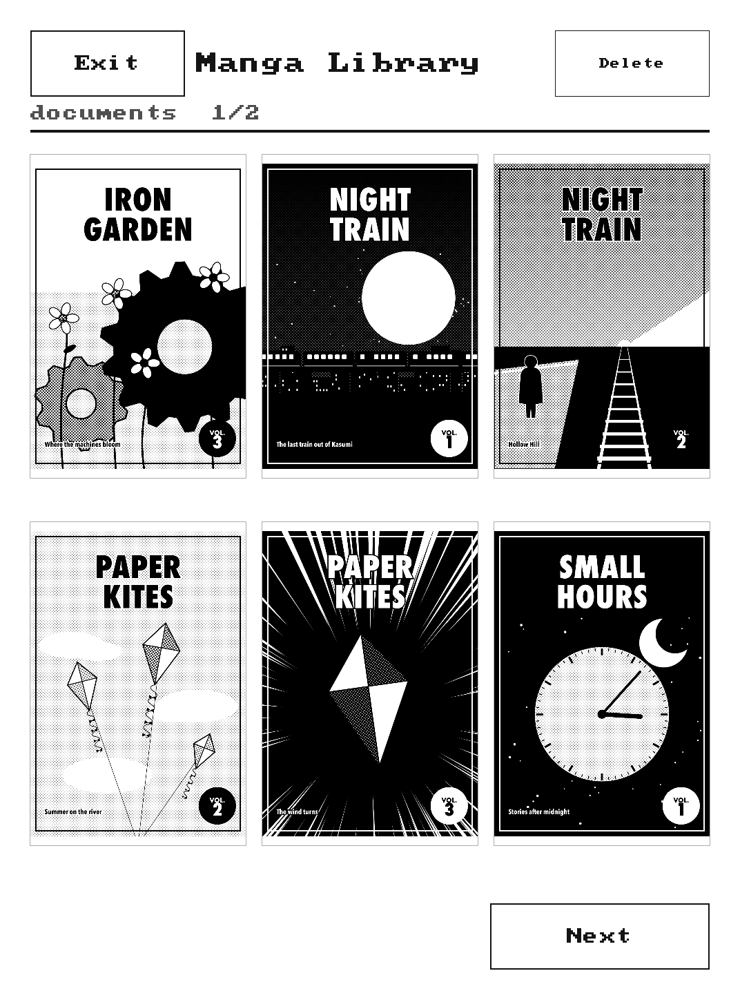
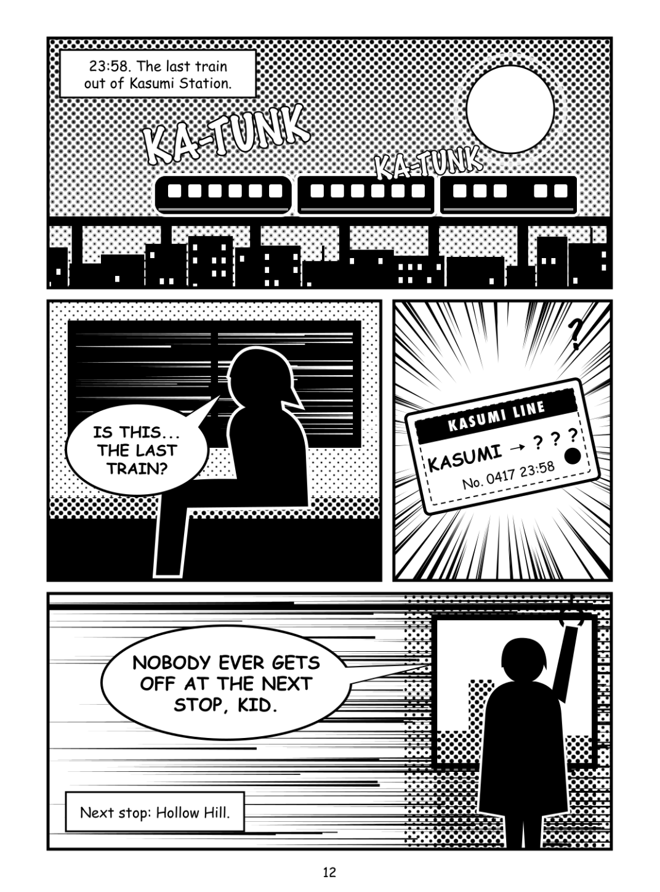
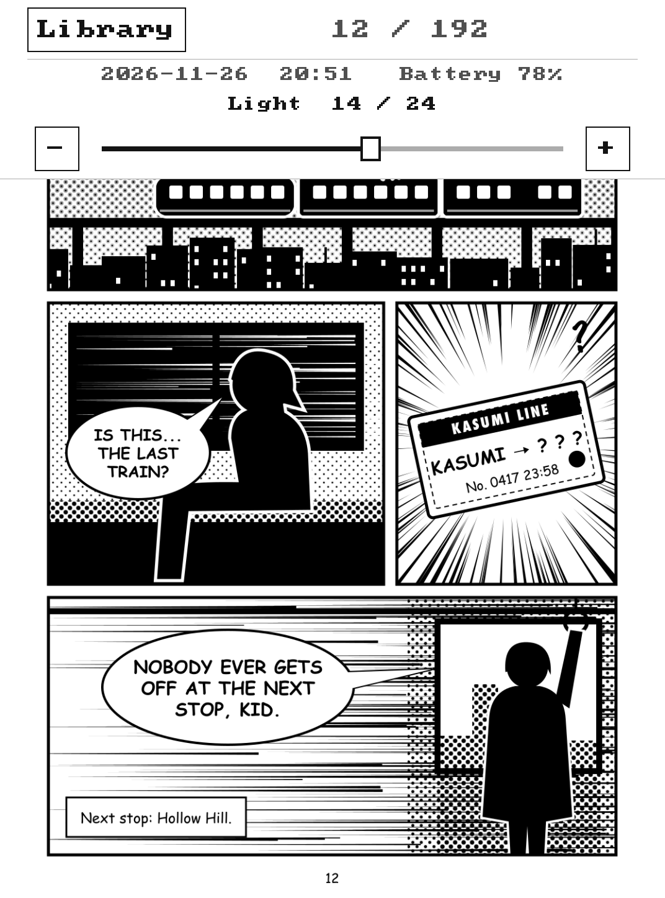
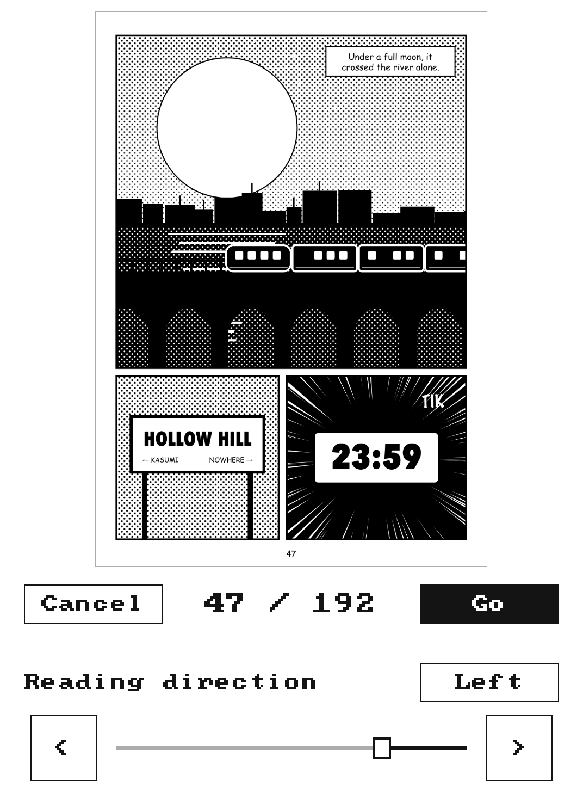

# Vector
The Kindle Manga Vector

Read manga encoded in HEIF/JPEG/PNG and packaged in ZIP archives or CBZ files.

Use the included [uploader](uploader/README.md) utility to upload the ZIP/CBZ files directly without any additional conversions.

<p>
  
  
  
  
</p>

## Prerequisites

In the vector directory run:

```sh
brew install cmake ninja pkgconf

./kindle/build-sdk.sh
```

This will build the Kindle SDK and place it by default in `$HOME/.local/opt/manga-kindle-sdk`. Use the `--install` option to specify a different SDK installation path.

## Build

In the vector directory run:

```sh
./kindle/build-viewer.sh
```

Use the `--sdk` option to use a custom SDK installation path that you specified with the `--install` option in `build-sdk.sh`. For example:

```sh
./kindle/build-sdk.sh --install "$HOME/SDKs/manga-kindle"
./kindle/build-viewer.sh --sdk "$HOME/SDKs/manga-kindle"
```

## Install

Connect the USB and make sure it is in transfer mode.

Run:

```sh
./kindle/install-viewer.sh
```

If you built with a custom SDK, pass the same path. For example:

```sh
./kindle/install-viewer.sh --sdk "$HOME/SDKs/manga-kindle"
```

## Open the Library instead of Home

After a reboot or when you leave an app such as Vector, the Kindle starts its home app (`com.lab126.KPPMainApp`) without a view, which opens the Home tab. A `defaultContext` for the app in the app registry makes the Kindle open the Library tab instead. Run this as root on the Kindle, for example with [Vector Shell](SHELL.md):

```sh
sqlite3 /var/local/appreg.db "insert or replace into properties (handlerId, name, value) values ('com.lab126.KPPMainApp', 'defaultContext', 'view=KPP_LIBRARY');"
```

The change takes effect immediately and survives reboots. A firmware update or factory reset may undo it. Books still return to the tab they were opened from, and the Home tab still opens Home. Tested on firmware 5.17.1.0.4.

To undo the change:

```sh
sqlite3 /var/local/appreg.db "delete from properties where handlerId = 'com.lab126.KPPMainApp' and name = 'defaultContext';"
```

## Screenshots

The screenshots show sample manga. To render them again after changing the viewer, run in the vector directory:

```sh
brew install librsvg libheif libzip

./screenshots/build-screenshots.sh
```

Use the `--sdk` option if you installed the SDK in a custom path.
